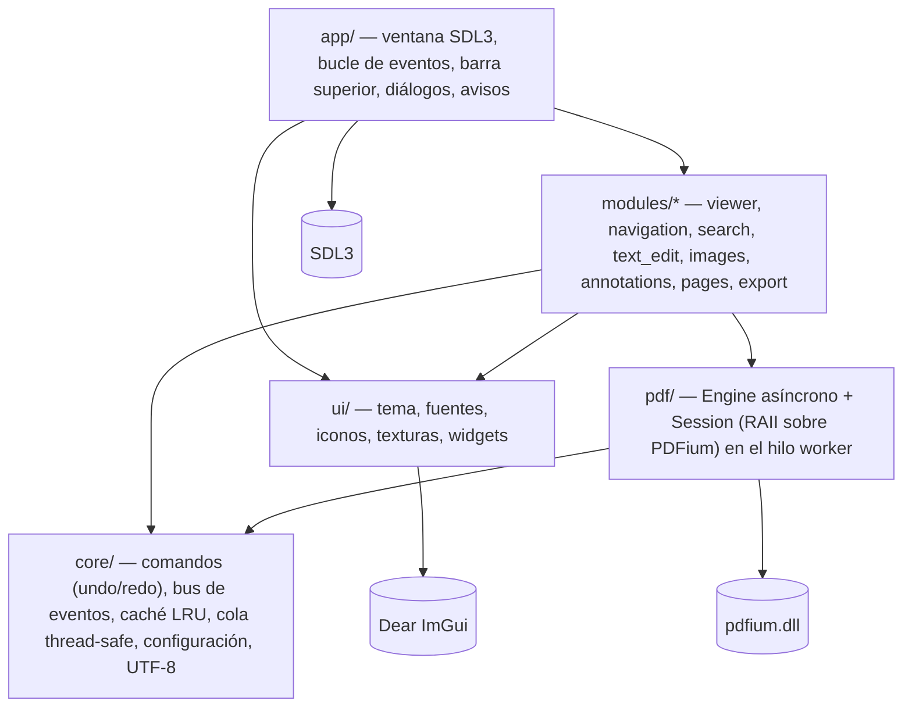
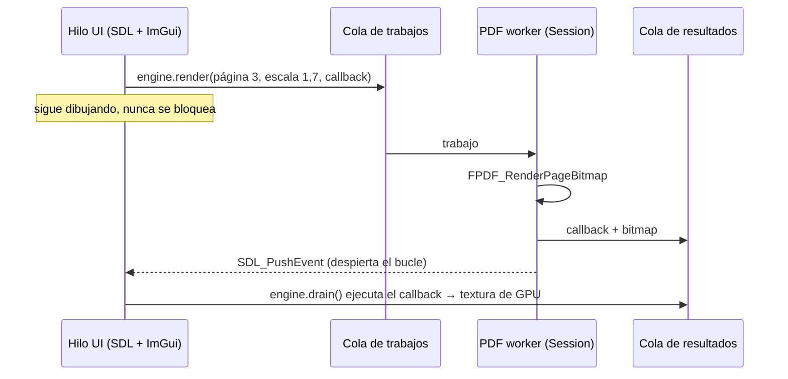
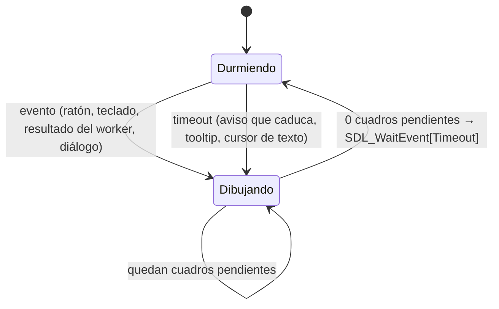
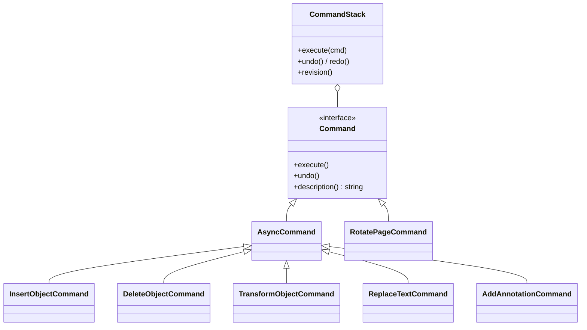

# Arquitectura

## Capas



Reglas:

- **Solo `pdf/` conoce PDFium.** CMake lo garantiza: `pdfium` se enlaza como `PRIVATE` en
  `pdflite_pdf`; ningún otro target tiene sus headers en el include path. Los tipos públicos
  (`pdf/types.hpp`) no mencionan nada de PDFium.
- **Los módulos no se conocen entre sí.** Hablan a través de `modules/context.hpp`:
  estado compartido (`AppContext`), bus de eventos, pila de comandos y el `Engine`.
- **`core` no depende de ImGui, SDL ni PDFium**: se prueba con doctest sin ventana.

## Hilos: el PDF worker

PDFium no es thread-safe. `pdf::Engine` arranca un hilo propio donde viven `pdf::Library`
(inicialización de PDFium) y `pdf::internal::Session` (el documento). Toda llamada a PDFium
ocurre ahí. La UI encola trabajos y recibe los resultados como callbacks:



- `core::ConcurrentQueue` (mutex + condition_variable) para ambas colas.
- `SDL_PushEvent` es thread-safe y despierta a `SDL_WaitEvent`; los avisos se *coalescen*
  con un `std::atomic<bool>` para no inundar la cola de SDL.
- Renders cancelables por canal (vista y miniaturas): al cambiar de zoom se invalidan los
  pendientes con un contador atómico de generación, y el worker los descarta sin renderizar.
- Abrir un archivo usa `FPDF_LoadCustomDocument` con un lector de bloques sobre
  `std::ifstream`: soporta rutas Unicode y no carga el PDF entero en RAM.

## Bucle principal



Tras cada evento se dibujan 3 cuadros (`frames_after_event`). Solo se usa un timeout si hay
algo con fecha: un aviso que caduca, un tooltip por aparecer o un campo de texto con el
cursor parpadeando. Sin nada de eso, la espera es indefinida (CPU 0 %).

## Memoria

- `modules::PageTextureCache`: LRU de texturas con límite **en bytes** (192 MB vista,
  24 MB miniaturas). Siempre devuelve la mejor textura disponible (aunque sea de otro zoom)
  mientras pide la buena: nunca hay parpadeo en blanco al hacer zoom.
- Solo se renderizan las páginas visibles (+1 de margen); las miniaturas usan
  `ImGuiListClipper`, que solo visita las filas en pantalla.
- La `Session` mantiene como máximo 24 páginas de PDFium cargadas (LRU), salvo las editadas,
  que se fijan para que sus `ObjectId` sigan siendo válidos.

## Edición y deshacer/rehacer



- **Quitar sin destruir**: `FPDFPage_RemoveObject` no destruye el objeto; la `Session` lo
  guarda (RAII) y deshacer/rehacer lo vuelve a insertar en la misma posición. Así un objeto
  conserva su `ObjectId` durante todo el historial.
- Los comandos son asíncronos. Mientras hay operaciones en vuelo (`doc.pending_edits`) se
  bloquean deshacer/rehacer y la edición: nunca se revierte algo cuyo resultado aún no llegó.
- Cada callback comprueba la *generación* del documento: si se cerró o reabrió, se ignora.
- "Modificado" = la revisión del historial difiere de la guardada, o hubo una operación no
  deshacible (`structure_dirty`).
- Guardar siempre usa `FPDF_SaveAsCopy(..., FPDF_NO_INCREMENTAL)` a un temporal y renombra.
  Si se sobrescribe el archivo abierto, se cierra y se reabre (PDFium lee de él bajo demanda).

## Módulos

```cpp
class Module {
public:
    virtual ~Module() = default;
    virtual std::string_view id() const = 0;
    virtual void init(AppContext&) = 0;
    virtual void draw_ui() = 0;           // paneles y ventanas propias
    virtual void draw_toolbar() {}        // botones en la barra superior
    virtual void handle_shortcuts() {}    // atajos globales
};
```

Se registran en tiempo de compilación en `create_modules()` (`src/app/app.cpp`). Para
colaborar sin conocerse, un módulo puede registrar en `AppContext`:

| Gancho | Uso |
|---|---|
| `page_overlays` | Dibujar sobre cada página visible (cajas de objetos, trazos) |
| `page_input_handlers` | Recibir clics/arrastres sobre páginas cuando su herramienta está activa |
| `context_bar_items` | Contenido de la barra contextual (solo en modo edición) |
| `page_context_menu` | Entradas del menú de clic derecho |
| `save_document` | (export) guardar desde el diálogo de cambios sin guardar |

Y comunicarse por eventos: `DocumentOpened`, `DocumentStructureChanged`, `PageEdited`,
`GoToPage`, `RevealRect`, `ToolChanged`, `PageOperation`.

### Ruta futura: plugins como DLL

Una interfaz C estable (`extern "C"`, structs POD, tabla de punteros a función con versión)
permitiría cargar plugins con `SDL_LoadObject`. Se pospone: la ABI de C++ entre DLL
compiladas con distintos compiladores no es estable, y la interfaz de módulos aún cambiará.

## Pruebas

| Nivel | Qué prueba | Cómo |
|---|---|---|
| `test_core.cpp` | LRU, cola, comandos, eventos, configuración, UTF-8 | Unitarias |
| `test_engine.cpp` | Engine + PDFium real | PDFs generados en memoria/disco |
| `test_ui.cpp` | La app completa | Ventana oculta + eventos SDL sintéticos ([ADR 0006](adr/0006-pruebas-de-interfaz.md)) |

## Decisiones

Ver [docs/adr/](adr/).
