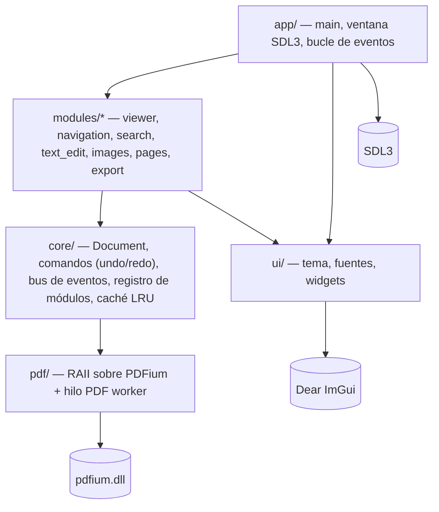
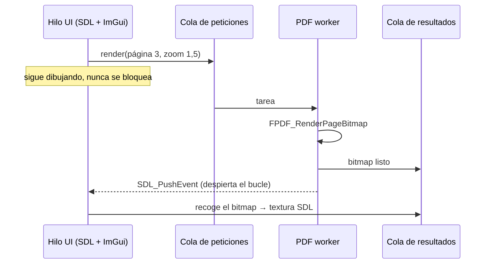
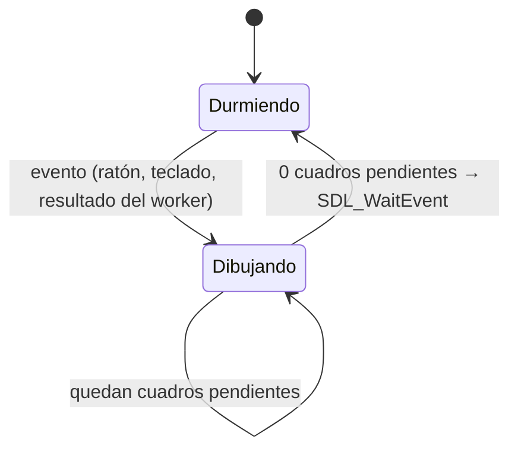

# Arquitectura

## Capas



Reglas:

- **Solo `pdf/` conoce PDFium.** CMake lo garantiza: `pdfium` se enlaza como `PRIVATE` en
  `pdflite_pdf`, así que ningún otro target tiene sus headers en el include path.
- **Los módulos no se conocen entre sí.** Se comunican mediante `core` (bus de eventos,
  comandos, documento compartido).
- **`core` no depende de ImGui ni de SDL**, para poder probarlo con doctest sin ventana.

## Hilos

PDFium no es thread-safe. Todas sus llamadas ocurren en un único hilo, el *PDF worker*:



`SDL_PushEvent` es thread-safe y despierta a `SDL_WaitEvent`, así que la UI duerme mientras
no haya ni interacción ni resultados pendientes.

## Bucle principal



Tras cada evento se dibujan unos pocos cuadros (`frames_after_event`) para que ImGui asiente
hover y animaciones. Con la ventana minimizada no se dibuja nada.

## Módulos (Fase 1+)

```cpp
class Module {
public:
    virtual ~Module() = default;
    virtual std::string_view id() const = 0;
    virtual void init(AppContext&) = 0;
    virtual void draw_ui() = 0;
};
```

Los módulos se registran en tiempo de compilación en una lista en `app/`. `AppContext` da
acceso a `core` (documento, comandos, eventos) pero nunca a otros módulos.

### Ruta futura: plugins como DLL

Una interfaz C estable (`extern "C"`, structs POD, tabla de punteros a función con versión)
permitiría cargar plugins con `SDL_LoadObject`. Se pospone hasta que la interfaz de módulos
se estabilice: una ABI C++ entre DLL compiladas con distintos compiladores no es estable.

## Decisiones

Ver [docs/adr/](adr/).
